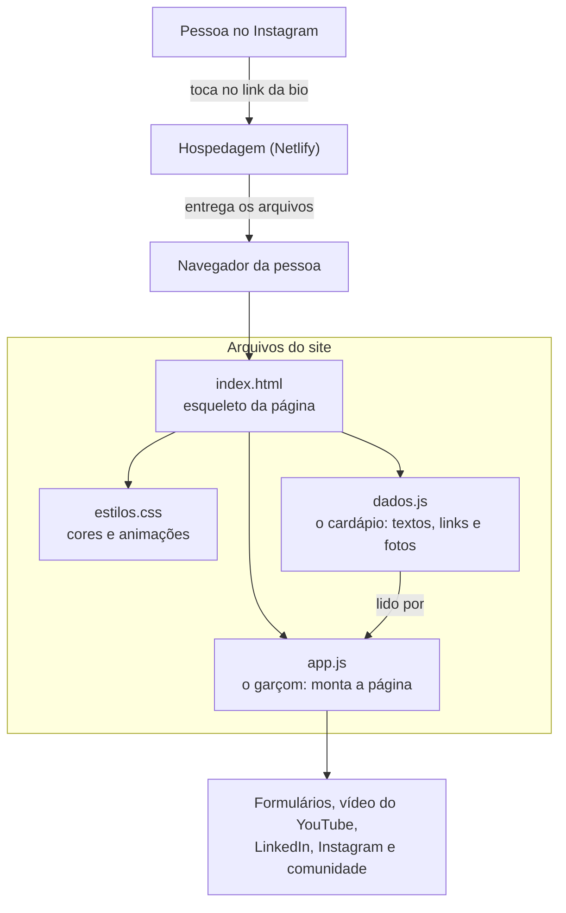
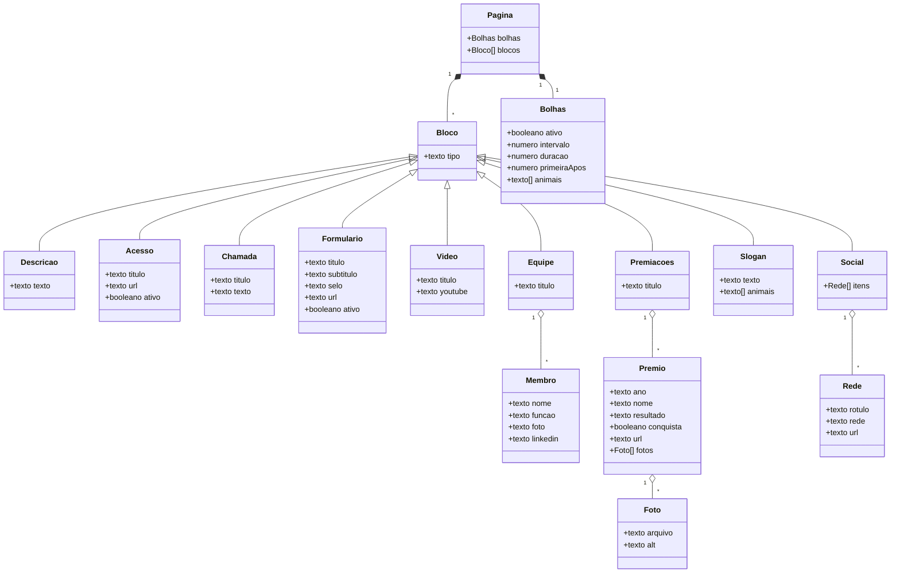

# Link na bio do Zoop

Página única, feita para o celular, que reúne em um só endereço tudo o que quem chega pelo Instagram do Zoop precisa: entender o projeto, assistir ao vídeo, responder aos formulários, conhecer a equipe e ver as conquistas.

## Acesse

> **Página no ar:** [zoopbio.netlify.app](https://zoopbio.netlify.app/)
>
> **Sistema do Zoop:** o botão "Acessar o Zoop" já está pronto no código e fica escondido até o sistema ser publicado.
>
> **Código-fonte:** este repositório.

## Por que existe

O Zoop é um projeto de TCC com a ambição de virar startup, e o grupo está sendo aceito em programas de aceleração. O Instagram só aceita um link na bio, então este site reúne tudo em um lugar só, rápido e bonito no celular.

## Como funciona

Para quem não programa, a página funciona como um cardápio. O **cardápio** é um arquivo com tudo o que deve aparecer (textos, links, fotos). O **garçom** é um programa pequeno que lê o cardápio e monta a página. O **visual** é outro arquivo, só com cores, tamanhos e animações. Como as três partes são separadas, trocar um texto ou um link não mexe no visual, e mudar o visual não mexe no conteúdo.



Os pontos principais da arquitetura:

- **Site estático:** não existe servidor próprio nem banco de dados. A hospedagem apenas entrega os arquivos, o que deixa a página rápida, barata e difícil de sair do ar.
- **Dados separados do visual:** mais adiante, o mesmo conteúdo pode vir de uma API ou de um banco, sem mudar a aparência.
- **Segurança:** todo texto entra como texto puro e só endereços `http` e `https` viram link, então um dado errado nunca vira código. A política de conteúdo (`netlify.toml`) só permite o próprio site, as fontes do Google e o player do YouTube.
- **Leveza:** o vídeo do YouTube só carrega quando a pessoa toca. Os animais são vídeos minúsculos (de 20 a 90 KB), pedidos só quando aparecem e descartados depois.
- **Responsivo:** uma coluna central, de celulares estreitos a monitores ultrawide.

## Modelagem

O conteúdo é uma lista de blocos, cada um de um tipo. O diagrama mostra o que cada bloco guarda.



## Estrutura de pastas

```
link_bioZoop/
├── index.html          Estrutura da página e os ícones
├── css/estilos.css     Aparência: cores, brilhos, animações e responsividade
├── js/dados.js         Conteúdo: tudo o que aparece vem daqui
├── js/app.js           Monta a página a partir dos dados
├── assets/             Logo, ícone, fotos da equipe, fotos das premiações e vídeos dos animais
├── netlify.toml        Segurança e cache na hospedagem (Netlify)
└── vercel.json         O mesmo, para quem preferir a Vercel
```

## Tecnologias

HTML, CSS e JavaScript puros, sem build e sem dependências. Hospedagem no Netlify, ligada a este repositório (a cada envio para o GitHub, a página é atualizada).

## Créditos

Os vídeos de animais vêm da Wikimedia Commons, com licença livre. Autores, licenças e endereços estão em [assets/animais/CREDITOS.md](assets/animais/CREDITOS.md).
